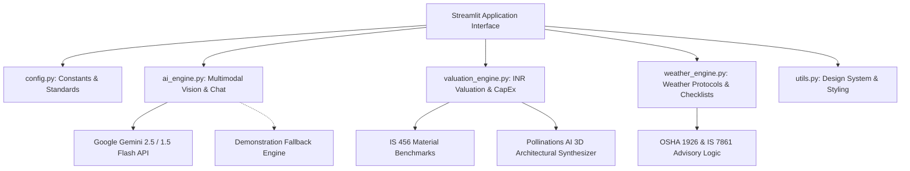

# 🏗️ Multimodal Construction Intelligence Platform
### Skill Wallet Capstone Project 1 • Platform ID: `6ac4c98d1dcde6d7857c1642`
**Category**: Generative AI | Real Estate Decision Support | Computer Vision

---

## 📌 Executive Summary
The **Multimodal Construction Intelligence Platform** is an enterprise-grade decision-support system built for civil engineers, site safety superintendents, project managers, and real estate developers. It synthesizes multimodal generative AI (Google Gemini 2.5 / 1.5) with Indian Standard civil engineering benchmarks (**IS 456:2000**, **IS 3786:1983**, **IS 2925**, **IS 3521**) and **OSHA 1926** safety mandates.

The platform provides a zero-dependency, 1-click cloud-deployable architecture featuring:
1. **Multimodal Site Safety & PPE Auditing (Epic 2)**: Analyzes construction site photos to evaluate worker PPE compliance (helmets, high-vis vests, steel-toe boots, fall harnesses) and flags workplace hazards with structured remedies.
2. **Forensic Crack Diagnostics & Structural Integrity (Epic 2)**: Classifies concrete defect types (Shear, Settlement, Thermal, Hairline, Spalling) with crack width metrics (mm), root-cause forensics, and repair specifications (IS 456 Cl. 40).
3. **Planning & Real Estate Valuation Engine (Epic 3)**: Computes CapEx, Cost-to-Complete, Current Asset Valuation, and Projected GDV in **INR (Lakhs & Crores)** across Indian city tiers, complete with material estimates and **Pollinations AI 3D architectural rendering**.
4. **Daily Weather-Aware Site Advisory & Multi-Turn Chatbot (Epic 5)**: Real-time wind speed limits for tower cranes, monsoon electrical safety, hot-weather concrete curing protocols (IS 7861), pre-shift supervisor checklists, and a chartered civil engineering AI assistant.

---

## 🏛️ System Architecture



---

## 🚀 Key Modules & Epic Coverage

### 🦺 1. Tab 1: Site Safety & PPE Audit (Epic 2)
- **Computer Vision Model**: Google Gemini 2.5 Flash Multimodal Vision (`types.Part.from_bytes` or `GenerativeModel`).
- **Standards**: OSHA 1926.100 (Head), OSHA 1926.201 (Hi-Vis), OSHA 1926.96 (Boots), OSHA 1926.502 (Fall Arrest), IS 2925, IS 3521.
- **Output JSON Data Contract**:
  - `safety_score` (0-100)
  - `overall_status` (Compliant, Non-Compliant, Critical Violation)
  - `ppe_detection` (detected counts, worker totals, compliance %)
  - `identified_hazards` (severity, location, standard violation, corrective remedy)
- **UI Elements**: KPI cards, colored status badges, responsive hazards dataframe, downloadable JSON and Markdown audit reports.

### 🔬 2. Tab 2: Crack Diagnostics & Structural Integrity (Epic 2)
- **Defect Taxonomy**:
  - Structural 45° Shear Cracks (Principal tensile failure per IS 456 Cl. 40)
  - Differential Settlement Cracks (Subgrade shear movement)
  - Thermal Expansion / Contraction Fractures
  - Plastic Shrinkage Hairline Cracks (<0.3mm)
  - Spalling & Delamination (Rebar corrosion carbonation)
- **Forensic Metrics**: Estimated crack width in mm, depth penetration, urgency rating, and estimated repair cost in INR.
- **Engineering Protocol**: Step-by-step injection grouting, V-grooving, port fixing, and Carbon Fiber Reinforced Polymer (CFRP) composite wrapping.

### 📊 3. Tab 3: Planning & Real Estate Valuation (Epic 3)
- **Inputs**: Built-up Sq.Ft (1,000 to 1,000,000), Location Tier (Tier 1 Metros: Mumbai/Bengaluru; Tier 2: Pune/Ahmedabad; Tier 3: Lucknow/Jaipur), Specification Grade, Completion Percentage slider.
- **Calculations in INR (Lakhs & Crores)**:
  - Total Construction Budget
  - CapEx Incurred to Date
  - Cost to Complete
  - Current Asset Market Valuation (Imputed Land + WIP)
  - Projected Gross Development Value (GDV)
  - Unrealized Developer Equity
- **Material Take-Off Estimates**:
  - Reinforcement Steel (Fe500D) in Metric Tonnes
  - Cement in 50kg Bags and MT
  - M-Sand and Coarse Aggregate in m³ / CFT
  - Water requirement in kL
- **3D Architectural Concept Synthesis**: Live integration with **Pollinations AI** generating photorealistic 3D architectural renderings tailored to building typology and aesthetic style.

### 🌦️ 4. Tab 4: Daily Site Assistant & Weather-Aware Advisory (Epic 5)
- **Weather Profiles**: High Wind (>45 km/h), Heavy Rain / Monsoon (>50 mm/day), Extreme Heat (>42°C), Dense Fog (<50m), Normal.
- **Operational Safety Protocols**:
  - Tower Crane jib free-slewing (wind-vane) directives
  - Elevated scaffold suspensions
  - 30mA ELCB tripping checks and trench dewatering
  - Cold/Hot weather concreting under **IS 7861 (Part 1 & 2)**
- **Site Supervisor Daily Checklist**: Interactive checkboxes with exportable shift briefing logs.
- **SiteIntel AI Chatbot**: Multi-turn civil engineering conversational assistant with pre-loaded quick prompt chips (Concrete Cover, OSHA Fall Protection, Slump Loss, Stop-Work Notices).

---

## 🛠️ Installation & Quickstart

### Prerequisites
- Python 3.9+ (Python 3.10 - 3.13 tested)
- Pip package manager

### 1. Clone & Setup Workspace
```bash
cd "project 1"
pip install -r requirements.txt
```

### 2. Generate Sample Specimen Images (Optional)
The pre-bundled sample images are included in `samples/`, but you can regenerate them anytime:
```bash
python generate_samples.py
```

### 3. Run Application Locally
```bash
streamlit run app.py
```
Open your browser at `http://localhost:8501`.

---

## 🌐 1-Click Cloud Deployment (Streamlit Community Cloud)

1. Push this repository to GitHub:
   ```bash
   git init
   git add .
   git commit -m "feat: Multimodal Construction Intelligence Platform v2.4"
   git remote add origin https://github.com/<your-username>/construction-intelligence-platform.git
   git push -u origin main
   ```
2. Navigate to [share.streamlit.io](https://share.streamlit.io/).
3. Connect your repository, set the main file path to `app.py`, and click **Deploy**.
4. *(Optional)* Add your `GEMINI_API_KEY` under **App Settings > Secrets**:
   ```toml
   GEMINI_API_KEY = "your_google_gemini_api_key_here"
   ```
   > **Note**: Even without an API key, the platform operates seamlessly using its built-in high-fidelity Demonstration Fallback Engine!

---

## 📜 Regulatory Standards & Codes Referenced
- **OSHA 1926 Subpart C & E**: General Safety and Personal Protective Equipment
- **OSHA 1926 Subpart M (1926.502)**: Fall Protection Systems Criteria
- **OSHA 1926 Subpart CC (1926.1400)**: Cranes and Derricks in Construction
- **IS 456:2000**: Plain and Reinforced Concrete - Code of Practice (Bureau of Indian Standards)
- **IS 3786:1983**: Method for Computation of Frequency and Severity Rates for Industrial Injuries
- **IS 2925:1984**: Specification for Industrial Safety Helmets
- **IS 3521:1999**: Industrial Safety Belts and Harnesses
- **IS 7861 (Part 1 & 2)**: Recommended Practice for Extreme Weather Concreting
